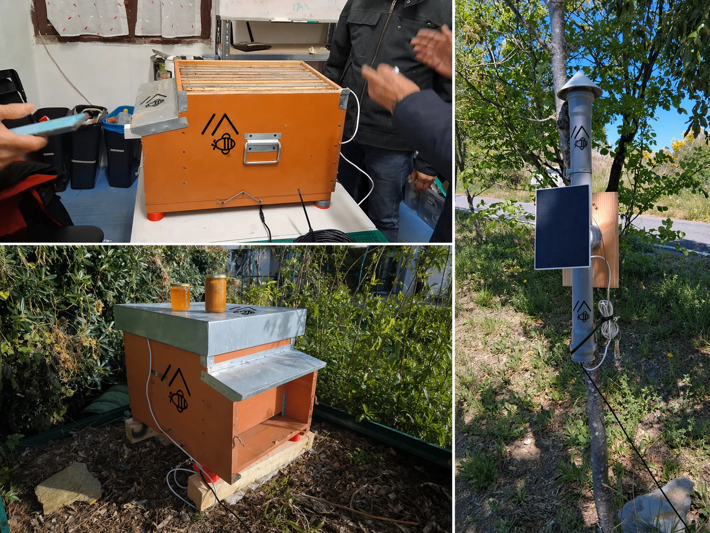
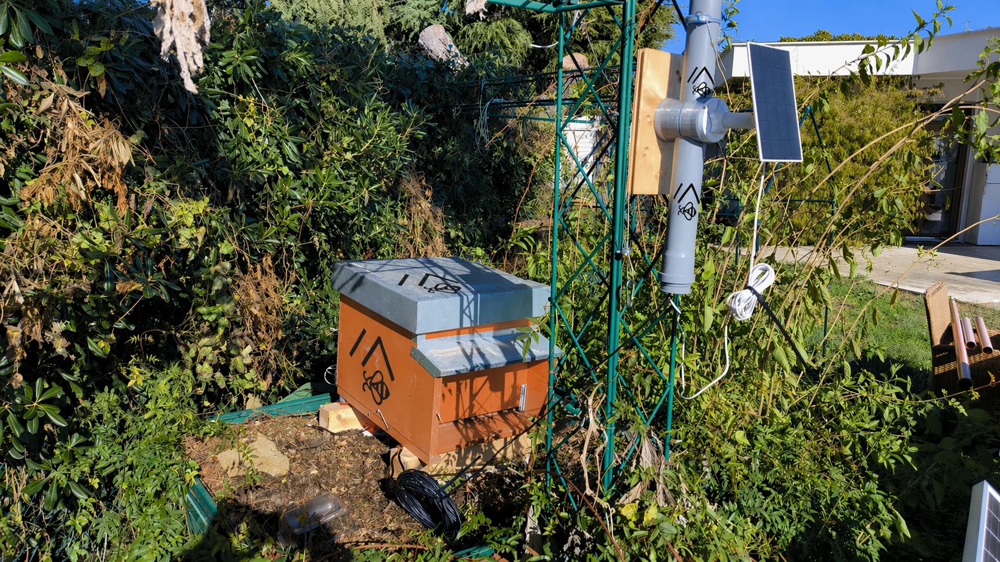
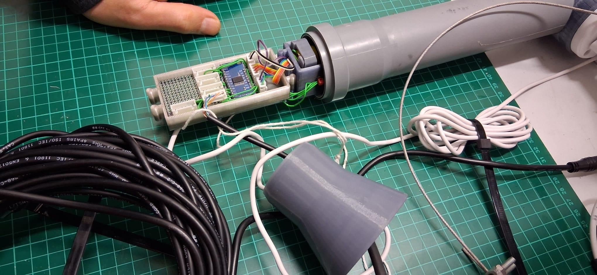

{ .mb-hero-logo }

# Listening to the hive, even from afar {.mb-hero-title}

MeshBee is a beehive monitoring system born at Fablab Imperia. Small solar-powered
devices weigh the hive and measure its temperature and humidity, then send the data
by radio all the way to the beekeeper's phone. Even where there's no mobile signal.
{ .mb-hero-lead }

[See how it works](#how-it-works){ .md-button .md-button--primary }
[Join the project](contribute.md){ .md-button }

A project by [Fablab Imperia APS](https://www.fablabimperia.org)
{ .mb-hero-byline }

{ loading=lazy }

## Bees tell us about the environment

Bees are among the best indicators of the health of a landscape. Watching a hive
means helping beekeepers with their work, but also keeping a close eye on
biodiversity, climate and the seasons.

A few numbers are enough to understand a lot:

- **Weight** tells you whether the bees are gathering nectar, whether the honey is
  ready, whether the colony has swarmed or is running out of stores.
- **Internal temperature** shows whether the brood is healthy and whether the colony
  can warm itself up and cool itself down.
- **Humidity** helps you see whether the hive is breathing properly.
- **Trends over time** show what's normal for that particular hive, so anything
  out of the ordinary stands out straight away.

Normally, finding all this out means driving to the apiary and opening the hive.
With MeshBee the data comes to you, and the bees are disturbed less.

## Why another smart hive?

Commercial systems exist, but they're often expensive, need a SIM card and a
subscription, and work poorly in exactly the countryside and mountain areas where
apiaries are found. MeshBee tries a different approach.

-   :material-sim-off:{ .lg .middle } **No SIM, no subscriptions**

    ---

    Data travels over long-range radio waves, not the phone network. It works even
    in valleys with no coverage, and costs nothing to run.

-   :material-white-balance-sunny:{ .lg .middle } **Powered by the sun**

    ---

    A small solar panel and rechargeable batteries make every device self-sufficient.
    Once it's installed, you can leave it to do its job.

-   :material-piggy-bank-outline:{ .lg .middle } **Low cost**

    ---

    Common electronic parts and a 3D-printed enclosure: one device costs less than
    a hundred euros and can look after several hives at once.

-   :material-hand-heart-outline:{ .lg .middle } **Open to everyone**

    ---

    Designs, software and instructions are free: anyone can study them, build them
    and improve them. No dependence on companies or closed platforms.

## How it works

1.  **The device in the hive** wakes up at regular intervals, measures weight,
    temperature and humidity, sends the data and goes back to sleep to save energy.
2.  **The message is passed from hand to hand.** The data is sent by radio using
    LoRa technology, which carries small messages for kilometres while using very
    little power. Every device on the network can pass on the others' messages,
    like runners in a relay race.
3.  **A collection point** connected to the internet receives the data and stores it.
4.  **On the phone** the beekeeper sees charts and trends for each hive, and gets
    an alert if something is wrong.

!!! tip "A network that grows with its community"

    MeshBee uses **Meshtastic**, a free radio network built by enthusiasts all over
    the world. Every new device installed makes the network stronger for everyone:
    in the province of Imperia there are already dozens.

## Handmade at the Fablab

Each device is housed in a weatherproof PVC pipe holding stackable 3D-printed
modules: battery, electronics, radio and antenna, the antenna itself home-built.
That makes it easy to assemble, repair and improve. The project was refined one
step at a time, testing the prototypes on real hives together with local beekeepers.

{ loading=lazy }

{ loading=lazy }

{ loading=lazy }

## Not just bees

The same technology can be used for much more: weather stations spread across the
landscape, environmental monitoring, keeping watch over remote sites, emergency
communications, citizen-science projects.

Next on MeshBee's list: listening to the vibrations and sounds of the hive, counting
bees coming in and going out, measuring air quality, and comparing seasons and
different apiaries.

!!! info "Come and see it live"

    MeshBee is one of the projects on show at **Maker Faire Rome 2026**: you'll find
    us at the Fablab Imperia stand, area V11 at the Gazometro.
    [Project page](https://makerfairerome.eu/espositori/?bb=51)

## Let's build it together

MeshBee is a volunteer project at **Fablab Imperia APS**, where makers, beekeepers and
radio enthusiasts work side by side. Whether you keep bees, love electronics or 3D
printing, or just want to find out more, there's a place for you.

[Get involved](contribute.md){ .md-button .md-button--primary }
[Visit Fablab Imperia](https://www.fablabimperia.org){ .md-button }

Want the technical details? You'll find everything in the [documentation](overview.md).
